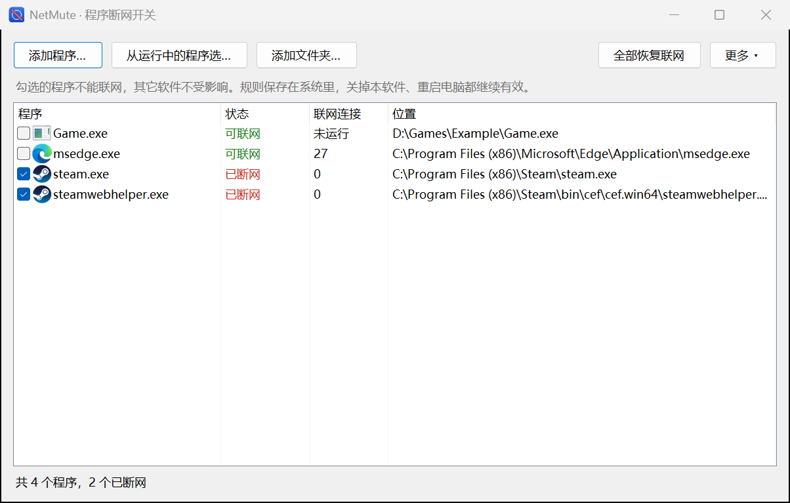

# NetMute · 程序断网开关

单独关掉某个程序的网络，其它软件照常上网。就像音量合成器里给单个程序静音，只不过静音的是网络。

Windows 10 / 11 可用。只有一个 exe（不到 200 KB），不用安装，不用装驱动，不用额外运行库。



[English](#english)

## 使用

1. 到 [Releases](https://github.com/Francisewais/NetMute/releases/latest) 下载 `NetMute.exe`，放到一个固定的文件夹里。
2. 双击运行，允许管理员权限（修改网络规则必须要）。
3. 把程序加进列表，它会**立刻断网**。三种加法：
   - 把 exe 或快捷方式拖进窗口
   - 点“添加程序…”
   - 点“从运行中的程序选…”，这里能看到每个程序有多少联网连接，最忙的排最前面
4. 取消勾选就恢复联网。

断网规则保存在 Windows 里，**不需要 NetMute 一直开着**。关掉它、重启电脑，规则都继续有效，直到你取消勾选。

经常切换的程序可以右键选“在桌面创建一键开关”，以后双击桌面图标就能切换（每次会弹一次管理员确认）。

> 第一次运行时 Windows 可能提示“已保护你的电脑”，因为这个 exe 没有付费代码签名：点“更多信息 → 仍要运行”。不放心的话可以[自己编译](#从源码编译)，一条命令就行，用的是 Windows 自带的编译器。

## 给 Steam 断网

- 只选 `steam.exe`：Steam 连不上服务器，下载和更新会停。
- 商店和社区页面是 `steamwebhelper.exe` 负责的。Steam 开着的时候添加 `steam.exe`，NetMute 会问你要不要把正在联网的 `steamwebhelper.exe` 等一起断掉。
- 游戏是独立的程序，网络不会被一起断掉。想断某个游戏，就单独添加游戏的 exe。Steam 桌面上的游戏图标是网址快捷方式，没法直接用，请到 `steamapps\common` 里选 exe，或者在游戏运行时从“运行中的程序”里选。

## 断掉的是什么

| 程序想做的事 | 结果 |
| --- | --- |
| 连互联网、局域网（IPv4 和 IPv6） | 拦截 |
| 别人主动连它 | 拦截 |
| 通过本机代理（Clash、v2rayN 等）上网 | 拦截 |
| TUN 模式、VPN 虚拟网卡 | 拦截 |
| 已经建立的连接 | 断网时立刻切断 |
| 程序自己内部的本机通信（127.0.0.1） | 放行 |
| 其它所有程序 | 完全不受影响 |

本机通信为什么要放行：很多程序的各个部分靠它互相说话，比如 `steamwebhelper.exe` 就是这样连 `steam.exe` 的。全部拦掉，程序可能直接打不开或者界面空白。

但只放行也不行，程序连上本机的代理软件就又出去了。所以本机连接里只拦代理端口：常见代理软件的默认端口，加上 Windows 代理设置里填的端口。

## 局限

- **路径变了规则就不认了。** 规则按 exe 的完整路径匹配。程序搬家，或者更新后路径带新版本号（比如 `app-1.2.3\xxx.exe`、`Agent.9852\Agent.exe`、商店应用的 `WindowsApps` 目录），都要重新添加。
- **系统服务代下载的流量管不到。** 比如微软商店的下载走 `svchost.exe`，给单个商店应用断网挡不住这部分。不建议给 `svchost.exe` 断网，那会影响很多东西，NetMute 会先警告。
- **自定义代理端口。** 如果代理端口既不是常见默认值，也没写进 Windows 代理设置，程序仍可能经由它上网。改过系统代理端口后，把已断网的程序取消勾选再勾上一次。
- **只管这台电脑上的程序。** 不是防火墙的替代品，也不防恶意软件：有管理员权限的程序可以自己删掉规则。

## 卸载

先点“更多 → 彻底清除所有规则”，再删掉 `NetMute.exe`。

**只删 exe 不会恢复网络**，因为规则在 Windows 里。如果已经删了，重新下载一个，运行清除即可。

## 命令行

```
NetMute block <程序>...     断网
NetMute unblock <程序>...   恢复联网
NetMute toggle <程序>       切换
NetMute list                列出已断网的程序
NetMute clear               全部恢复，并删除留在系统里的所有内容
NetMute selftest            自检
```

`<程序>` 可以是 exe 路径、快捷方式，或者正在运行的程序名（比如 `steam.exe`）。

## 它可靠吗

`NetMute selftest` 会在你的电脑上实际验证：拿一份系统自带 `curl.exe` 的副本当被断网的程序，用真实连接检查它上不了网、也连不上本机代理端口，而其它程序照常联网，最后删掉所有测试规则。窗口里也能跑：“更多 → 运行自检”。

每个发布版本都由 [GitHub Actions](.github/workflows/build.yml) 从源码编译，在真实的 Windows 上跑过同样的自检，以及命令行和窗口操作的测试，才会发布。

## 和其它办法比

- **Windows 防火墙出站规则**：系统自带，不用装东西。但只有防火墙开着才生效，要手动选路径、手动建规则，也不处理本机代理和已有连接。
- **[simplewall](https://github.com/henrypp/simplewall)、[Fort Firewall](https://github.com/tnodir/fort)**：完整的防火墙，功能强得多。如果你要逐个审批程序联网、看流量日志，用它们更合适。NetMute 只做一件事：把这一个程序的网关掉。

## 从源码编译

```
build.cmd
```

产物是 `bin\NetMute.exe`。用的是 Windows 自带的 .NET Framework 编译器，不需要装 Visual Studio 或 SDK，所以代码也只用到 C# 5 的语法。

代码在 [`src`](src) 里，断网的核心是 [`Firewall.cs`](src/Firewall.cs)。原理是直接调用 [Windows 筛选平台（WFP）](https://learn.microsoft.com/windows/win32/fwp/windows-filtering-platform-start-page)，也就是 Windows 防火墙底下那一层，所以防火墙关着也有效：

- 建一个最高优先级的子层，给每个程序加 6 条持久规则：出站和入站（IPv4、IPv6）拦截所有非本机流量，出站（IPv4、IPv6）再拦截本机代理端口。
- 不装驱动，不注入进程，不改 Windows 防火墙的任何设置。

`tools\test-cli.ps1` 和 `tools\test-ui.ps1` 用真实连接测试命令行和窗口操作（会清空所有规则，所以只在测试机上跑）。`NetMute render main out.png` 能不用管理员权限把窗口画成图片，方便检查界面。

## 开源协议

[MIT](LICENSE)

---

## English

NetMute cuts off the network for single programs on Windows 10/11 and leaves everything else alone, like muting one app in the volume mixer. One small exe, no install, no driver.

**Use it:** download `NetMute.exe` from [Releases](https://github.com/Francisewais/NetMute/releases/latest), run it, approve the admin prompt, and add a program (drag it in, browse for it, or pick from the running programs). It loses its network right away; uncheck it to give it back. Rules live in Windows, so they keep working after NetMute closes and after a reboot.

**What gets blocked:** internet and LAN in both directions on IPv4 and IPv6, including traffic through a local proxy client on the usual proxy ports or the port in your Windows proxy setting, and connections that are already open. Other loopback traffic stays allowed, because many programs need it internally: `steamwebhelper.exe` reaches `steam.exe` that way.

**Limits:** rules follow the exe's full path, so a program that moves, or updates into a new versioned folder, must be added again. Traffic that system services carry for a program (Microsoft Store downloads through `svchost.exe`) is out of reach. It is not a security tool: anything running as administrator can remove the rules.

**Uninstall:** More → Remove all rules, then delete the exe. Deleting only the exe leaves the rules in place.

**Command line:** `NetMute block|unblock|toggle <program>...`, `NetMute list`, `NetMute clear`, `NetMute selftest`.

**Build:** run `build.cmd`. It uses the C# compiler that ships with Windows, so no SDK is needed. The blocking is done through the [Windows Filtering Platform](https://learn.microsoft.com/windows/win32/fwp/windows-filtering-platform-start-page), so it also works with Windows Firewall turned off. See [`src/Firewall.cs`](src/Firewall.cs).

**License:** [MIT](LICENSE)
